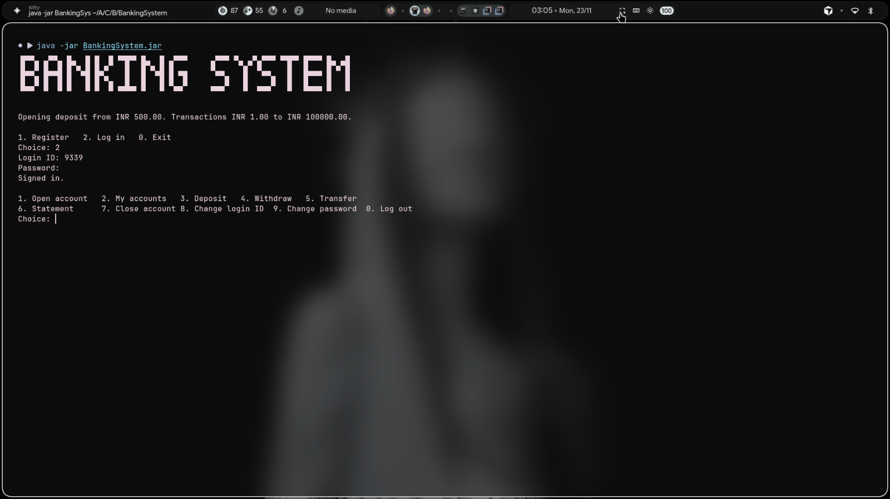
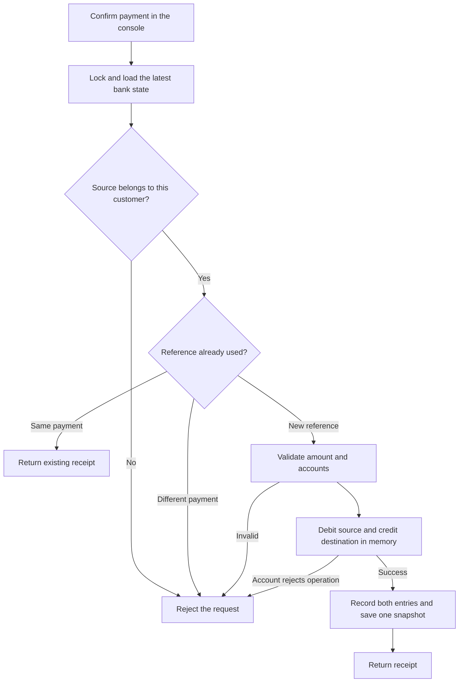

  

# Banking System

A Java console application for managing simulated bank accounts in Indian rupees. Register a customer, open accounts, and move money between them. Each payment appears on both account statements, and balances are saved locally when you exit.

## Run from source

Install a **JDK 17 or newer**. Open a terminal in the folder containing [build.gradle](build.gradle) and run the command for your system. The Gradle wrapper downloads the build tools and dependencies on the first run.

| | Command |
| --- | --- |
| Linux or macOS | `./gradlew --console=plain run` |
| Windows PowerShell | `.\gradlew.bat --console=plain run` |

In IntelliJ IDEA, open the same folder as a Gradle project. You can use its Terminal or select **Gradle → Tasks → application → run**. When you change the source, stop the running app and run the task again to see your edits.

## Try it with two accounts

1. At the welcome menu, choose **1. Register**. Pick a login ID and password. Registration signs you in. Your customer profile can own several accounts.
2. Choose **1. Open account** twice. Open the first account with `1000` and the second with `500`. Choose **2. My accounts** to see their ten-digit account numbers. Copy the second number.
3. Choose **5. Transfer**. Select the first account as the source, enter the second account's number as the destination, enter `200`, and use `demo-001` as the reference. Review the details and enter `y`.
4. Choose **6. Statement** for each account. Look for the entries that share the reference `demo-001`.

| Account | Opening deposit | Transfer entry | Balance after transfer |
| --- | ---: | --- | ---: |
| First | ₹1,000.00 | `TRANSFER_OUT` −₹200.00 | ₹800.00 |
| Second | ₹500.00 | `TRANSFER_IN` +₹200.00 | ₹700.00 |

Repeat step 3 with the **same reference and details**. The app returns the original transfer receipt, so the balances stay at ₹800 and ₹700. This is **idempotency**. For a genuinely new payment, use a new reference or press Enter to generate one.

## How the application works

[BankingApplication](src/main/java/com/abhijai/banking/app/BankingApplication.java) selects the data directory, loads the saved state and banking rules, then passes the services into [ConsoleUI](src/main/java/com/abhijai/banking/console/ConsoleUI.java). The console keeps the signed-in customer's ID and uses it when calling a service. For example, a withdrawal includes the customer ID as well as the account number so the service can check ownership.

| Menu action | Code to follow | What happens |
| --- | --- | --- |
| Register or log in | [AuthenticationService](src/main/java/com/abhijai/banking/service/AuthenticationService.java) | Registration creates a customer ID. Login looks up the login ID without case sensitivity and checks the password using [PasswordHasher](src/main/java/com/abhijai/banking/security/PasswordHasher.java). Each password has a random salt and a PBKDF2-HMAC-SHA256 hash. |
| Open, list or close accounts | [AccountService](src/main/java/com/abhijai/banking/service/AccountService.java) | Opening creates an account linked to its owner and records the opening deposit as its first entry. Closing requires a zero balance. Its statement remains available afterward. |
| Deposit, withdraw or transfer | [TransactionService](src/main/java/com/abhijai/banking/service/TransactionService.java) | The service checks ownership and amount limits. A [BankAccount](src/main/java/com/abhijai/banking/domain/BankAccount.java) enforces its status and available balance. [Money](src/main/java/com/abhijai/banking/domain/Money.java) uses two-decimal `BigDecimal` amounts to preserve exact paise. |
| Read a statement | [StatementService](src/main/java/com/abhijai/banking/service/StatementService.java) | The owner sees entries in posting order with UTC time, signed amount, balance after each entry and any transfer reference. |
| Change credentials or log out | [ConsoleUI](src/main/java/com/abhijai/banking/console/ConsoleUI.java) | Changing a login ID or password requires the current password. Logging out clears the session and returns to the welcome menu. |

### What happens when you confirm a transfer?

To trace the diagram, start in `TransactionService.transfer()` and step into [JsonBankingRepository.update()](src/main/java/com/abhijai/banking/persistence/json/JsonBankingRepository.java). The repository takes a file lock so two running copies cannot update the same balances at once. It loads a fresh snapshot, then runs the transfer on that in-memory copy.

Suppose the destination account has closed. The debit can succeed in memory before the destination rejects the credit. The exception exits the update before the file is written. The sender keeps the original balance and neither statement gains an entry. Saving both sides together is called **atomicity**.

## Rules and storage

The defaults are in [banking.properties](src/main/resources/banking.properties). The opening deposit must be at least **₹500**. Each subsequent deposit, withdrawal or transfer must be between **₹1 and ₹1,00,000**, inclusive. Five failed login attempts trigger a five-minute cooldown that survives a restart.

The app prints its data directory at startup. By default, it uses `data/` under the working directory. Start from the same directory on future runs to see the same accounts.

| File | Purpose |
| --- | --- |
| `banking.json` | Current customers, accounts, transfers and statement entries. Jackson converts between Java objects and JSON. On load, the app checks balances against the statements and verifies both sides of each transfer. |
| `banking.json.bak` | Previous saved snapshot after a subsequent change. The repository writes the new snapshot to a temporary file before replacing the current file. |
| `banking.lock` | Coordinates file access across running copies that use the same data directory. |

To practise with separate data, run `./gradlew --console=plain run --args="--data-dir practice-data"`. If the main snapshot there is missing or damaged and a backup exists, run `./gradlew run --args="--data-dir practice-data --restore-backup"`. Recovery restores the previous saved version and preserves a copy of a damaged main file. Use sample data for practice because the JSON contains readable account and transaction details.

## Test and package

| Goal | Gradle command | Result |
| --- | --- | --- |
| Run the tests | `./gradlew test` | Open `build/reports/tests/test/index.html` for the results. |
| Build a shareable copy | `./gradlew portable` | Distribute the entire `build/portable/` folder. It contains the application JAR and its runtime libraries under `lib/`. |
| Launch the rebuilt copy | `java -jar build/portable/BankingSystem.jar` | Runs the version produced by the most recent portable build. |

On Windows, use `.\gradlew.bat` for the Gradle commands. For an executable example of the payment flow, open [BankingWorkflowTest](src/test/java/com/abhijai/banking/service/BankingWorkflowTest.java) and run `transferWritesTwoMatchingEntriesAndSurvivesRestart`. Its assertions show exactly which balances, entries and reference should survive a restart.
